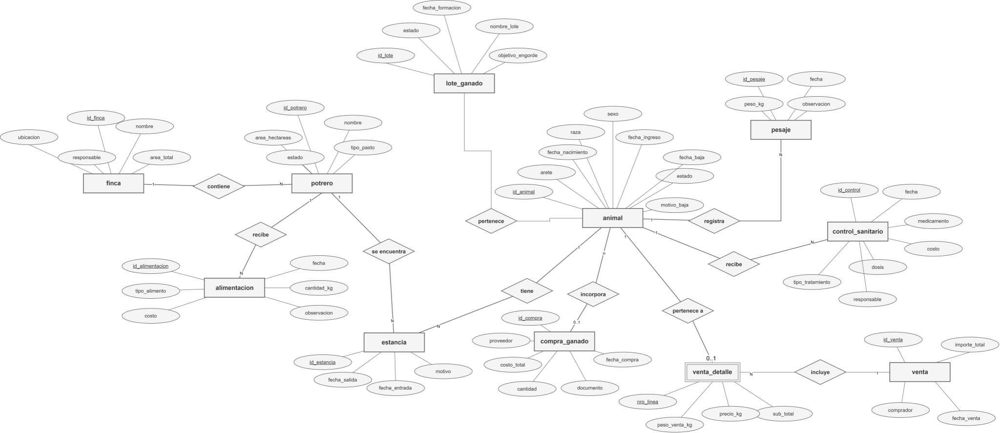
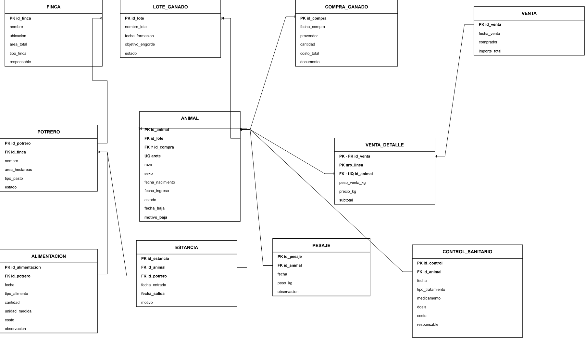

# Base de datos para la gestión de ganado bovino


## Diagramas de la base de datos

### Modelo Entidad–Relación (notación Chen)

Representa las entidades, sus atributos, relaciones y cardinalidades.

[](modelo_er.svg)

**[Ver imagen en tamaño completo](modelo_er.svg)** · **[Abrir archivo editable en draw.io](Modelo%20Entidad%20Relacion.drawio)**

### Modelo relacional

Muestra las tablas, sus atributos y las relaciones mediante claves primarias (PK) y foráneas (FK).

[](modelo_r.svg)

**[Ver imagen en tamaño completo](modelo_r.svg)** · **[Abrir archivo XML de draw.io](Modelo%20Relacional.xml)**


## Organización del proyecto

```text
.
├── SQL/                              # Scripts SQL del proyecto
├── Modelo Entidad Relacion.drawio      # Diagrama conceptual editable
├── Modelo Relacional.xml              # Diagrama relacional editable
├── docs/
│   └── diagramas/
│       ├── entidad-relacion.svg        # Vista previa del modelo E-R
│       └── modelo-relacional.svg       # Vista previa del modelo relacional
└── README.md
```
